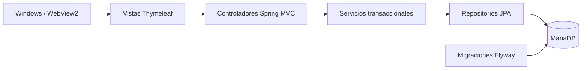

# Emporio · Ventas, inventario y bodega


Sistema para registrar ventas, controlar existencias por lote y consultar ubicaciones y vencimientos. Desarrollado para el contexto del Emporio Frutos Secos y Quesos / Comercializadora Ángel de Ovalle, con interfaz web y aplicación de escritorio Windows que utilizan el mismo backend.

## Qué resuelve

- Catálogo de productos con precios en CLP, unidades y stock mínimo.
- Entradas por lote, proveedor, ubicación, calidad y vencimiento.
- Ventas de varios productos, por unidad o a granel con tres decimales en kg.
- Descuento FEFO: consume primero los lotes aptos que vencen antes.
- Traslados, conteos, mermas y retención de lotes, con historial y responsable.
- Alertas de reposición y vencimiento, exportación CSV y anulación de ventas.
- Roles Administración / Ventas, protección CSRF y cambio de contraseña desde Mi cuenta.

## Arquitectura



Las operaciones de stock se ejecutan en transacciones. Los bloqueos por producto protegen las ventas simultáneas; los lotes vencidos o retenidos quedan fuera del stock vendible. Una venta con stock insuficiente revierte todos sus cambios.

## Versión y procedencia

Los directorios **Backend**, **Frontend** y **Escritorio**, junto con `LEEME.txt`, contienen los archivos de código de la entrega final **Emporio-Web-y-App.zip**, conservados sin modificar. `source-manifest.json` registra sus hashes SHA-256 para comprobarlo.

El repositorio añade documentación y un módulo de verificación independiente. No contiene las credenciales, datos de MariaDB, respaldos ni ejecutables de la instalación privada. El ZIP de entrega se conserva fuera del repositorio.

## Estructura

| Directorio | Contenido |
| --- | --- |
| `Backend` | Java, Spring Boot, entidades, servicios, controladores y migraciones |
| `Frontend` | Plantillas HTML, CSS, JavaScript y marca SVG |
| `Escritorio` | Código C#, abridores, scripts y bibliotecas WebView2 de la entrega |
| `verification` | Pruebas existentes del proyecto, ejecutadas sobre las fuentes finales |
| `docs` | Guía de compilación y alcance de la publicación |

## Compilar y ejecutar la web

Requisitos: **JDK 17 o superior**, Maven y una base MariaDB vacía para esta aplicación. El backend incluye el directorio Frontend al compilar; ambos deben permanecer juntos.

```powershell
mvn -B -f Backend/pom.xml package
```

Crea la base `emporio` con codificación `utf8mb4` y un usuario con permisos para aplicar las migraciones y operar sobre esa base. Después configura la conexión y una contraseña inicial propia para el administrador:

```powershell
$env:DB_URL = 'jdbc:mariadb://127.0.0.1:3306/emporio'
$env:DB_USER = 'usuario_de_la_aplicacion'
$env:DB_PASSWORD = 'tu_clave_local'
$env:ADMIN_PASSWORD = 'elige_una_clave_inicial_propia'
java -jar Backend/target/emporio-1.0.0.jar
```

Abre **http://127.0.0.1:8080**. El usuario inicial es `admin`; la contraseña debe tener al menos 10 caracteres y hasta 72 bytes. Se utiliza solo al crear la primera cuenta y no reemplaza una contraseña existente. La ejecución escucha en este equipo por defecto.

Flyway crea el esquema y Hibernate lo valida. Las credenciales se configuran localmente y no se guardan en Git. Puedes conectar DBeaver con los mismos parámetros de MariaDB.

## Aplicación de escritorio

La entrega final incorpora abridores para la aplicación Windows y la página web. El código se conserva en `Escritorio`; para compilarlo en Windows, sigue [la guía de escritorio](docs/ESCRITORIO.md).

Compilar el backend no genera automáticamente el paquete portable completo. Ese paquete también necesita Java, MariaDB y la estructura de ejecución descrita en la guía.

## Verificación

```powershell
mvn -B -f verification/pom.xml test
python scripts/check-source-integrity.py
```

El módulo de pruebas compila directamente `Backend/src/main/java` y carga las vistas de `Frontend`. Usa H2 en memoria por defecto; no se conecta a tu instalación privada ni altera las fuentes finales.

Para ejecutar las mismas pruebas contra MariaDB, configura `TEST_DB_URL`, `TEST_DB_USER` y `TEST_DB_PASSWORD` apuntando **exclusivamente a una base de pruebas vacía**:

```powershell
mvn -B -f verification/pom.xml test -Dtest.profile=maria-test
```

Las pruebas vacían tablas de inventario de esa base. GitHub Actions usa entornos aislados para compilar, probar y comprobar la integridad de las fuentes.

## Alcance

Las ventas son registros internos: no emiten boletas ni facturas del SII. La validación con las personas del negocio, su catálogo y sus reglas operativas sigue siendo necesaria. El MVP no integra balanzas ni códigos de barras, órdenes de compra o devoluciones parciales. El listado de ventas muestra los últimos 100 registros y el de movimientos los últimos 200; el historial completo permanece en MariaDB.

Las bibliotecas WebView2 conservan sus [licencias](Escritorio/dependencias/webview2/LICENSE.txt) y avisos originales. No se asigna una licencia nueva al código del proyecto sin una decisión del titular.

Repositorio de portafolio: [Sokir1](https://github.com/Sokir1).
